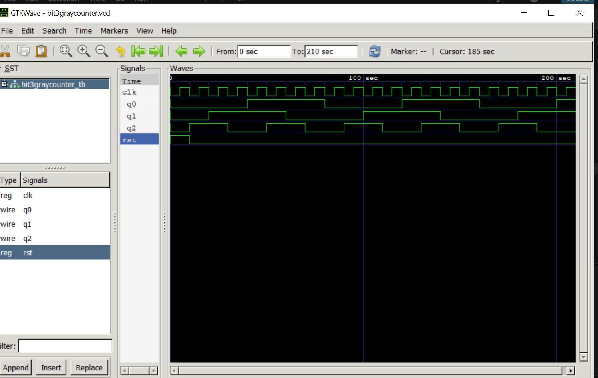
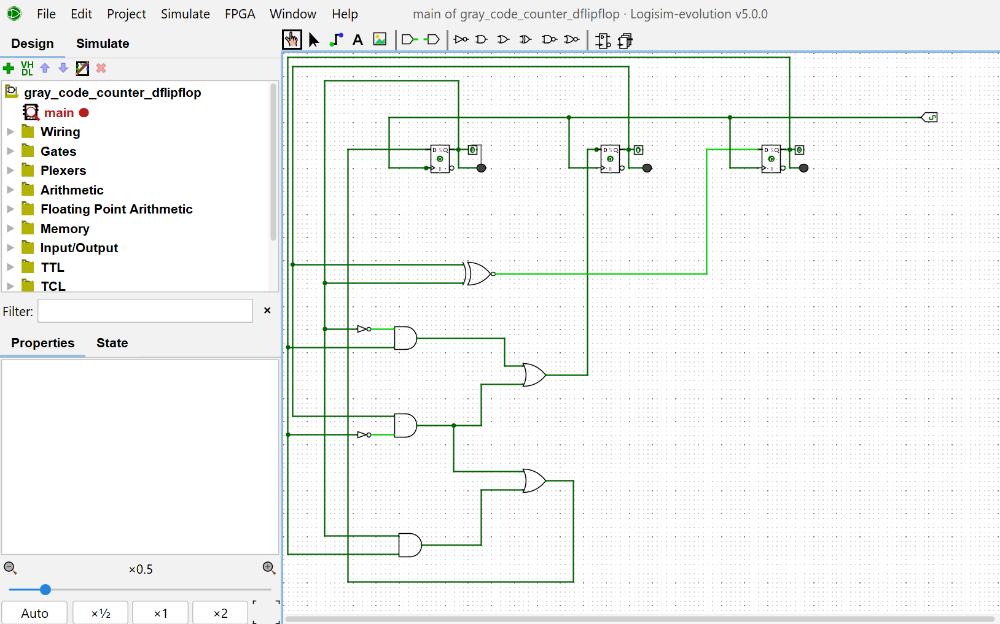

# 3-Bit Gray Code Counter

A 3-bit Gray code counter designed in Verilog, verified using a testbench and GTKWave, synthesized using Yosys, and implemented on real hardware as a semester project.

In a Gray code sequence only one bit changes between consecutive states, which avoids glitches in digital systems.

## Counting Sequence
000 → 001 → 011 → 010 → 110 → 111 → 101 → 100 → 000

## Tools Used
- Verilog HDL
- Icarus Verilog
- GTKWave
- Yosys
- Graphviz

## Files
- `bit3graycounter.v` — Counter RTL design
- `bit3graycounter_tb.v` — Simulation testbench
- `bit3graycounter.vcd` — Simulation dump file
- `bit3graycounterwaveform.png` — Verified simulation waveform
- `bit3garycodecountersch.png` — Synthesized schematic
- `bit3graycounter.png` — Circuit diagram
- `bit3graycodecountervid.mp4` — Hardware demo video

## Verification
The design was simulated using the testbench, and the output waveform was inspected using GTKWave.

## Synthesis
The design was synthesized using Yosys and the schematic was generated using Graphviz.

## Hardware Implementation
The counter was also implemented and tested on physical hardware. Watch the demo video below.

(Drag and drop bit3graycodecountervid.mp4 here to embed it)

## Learning Outcomes
- Translating digital logic equations into Verilog
- Writing clocked sequential logic
- Implementing synchronous reset
- Developing a testbench and inspecting simulation waveforms
- Synthesizing a design with Yosys and viewing the schematic
- Building and testing the design on real hardware
