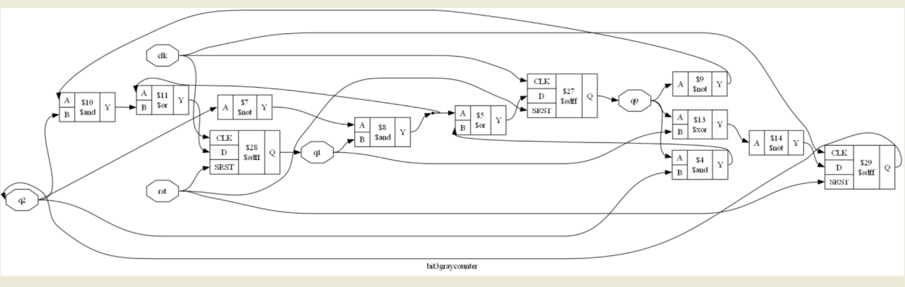

# 3-Bit Gray Code Counter

A 3-bit Gray code counter designed in Verilog, verified using a testbench and GTKWave, synthesized using Yosys, and implemented on real hardware as a semester project.

## Hardware Demo Video

Click the image above to watch the 3-bit Gray code counter running on real hardware.

## Overview
A Gray code is a binary numbering system in which only **one bit changes** between two consecutive values. In a normal binary counter, several bits can change at once (for example 011 → 100 changes all three bits). Because real signals never switch at exactly the same instant, this can create short wrong values, called glitches. A Gray code counter avoids this problem, which is why it is used in rotary encoders, analog-to-digital converters, and FIFO pointers that cross clock domains.

## Features
- 3-bit synchronous counter, output changes on the clock edge
- Synchronous reset
- Only one output bit changes per clock pulse
- Counts through 8 states and wraps around automatically
- Verified by simulation, synthesized, and tested on hardware

## Counting Sequence
000 → 001 → 011 → 010 → 110 → 111 → 101 → 100 → 000

| Count | Binary | Gray Code (Q2 Q1 Q0) |
|:-----:|:------:|:--------------------:|
| 0 | 000 | 000 |
| 1 | 001 | 001 |
| 2 | 010 | 011 |
| 3 | 011 | 010 |
| 4 | 100 | 110 |
| 5 | 101 | 111 |
| 6 | 110 | 101 |
| 7 | 111 | 100 |

Binary to Gray conversion: `Gray = Binary ^ (Binary >> 1)`

## Tools Used
- Verilog HDL
- Icarus Verilog
- GTKWave
- Yosys
- Graphviz
- VS Code

## Files
- `bit3graycounter.v` — Counter RTL design
- `bit3graycounter_tb.v` — Simulation testbench
- `bit3graycounter.vcd` — Simulation dump file
- `bit3graycounterwaveform.png` — Verified simulation waveform
- `bit3garycodecountersch.png` — Synthesized schematic
- `bit3graycounter.png` — Circuit diagram
- `bit3graycodecountervid.mp4` — Hardware demo video

## Design Flow
1. **Design:** Counter written in Verilog (`bit3graycounter.v`)
2. **Verification:** Testbench applies clock and reset, and the waveform is checked in GTKWave
3. **Synthesis:** Design converted to a gate-level netlist using Yosys
4. **Schematic:** Circuit diagram generated using Graphviz
5. **Hardware:** Design built and tested on a physical setup

## Verification
The design was simulated using the testbench, and the output waveform was inspected using GTKWave. The waveform confirms that the output follows the Gray code sequence and that only one bit changes on every clock edge.

## Synthesis
The design was synthesized using Yosys and the schematic was generated using Graphviz.

## Circuit Diagram

## Hardware Implementation
The counter was also implemented and tested on physical hardware. The output bits were observed on LEDs, and they follow the same Gray code sequence seen in the simulation. The full working demo is shown in the video at the top of this page.

## How to Run
Compile and simulate:

    iverilog -o sim bit3graycounter_tb.v bit3graycounter.v
    vvp sim

View the waveform:

    gtkwave bit3graycounter.vcd

Synthesize with Yosys:

    yosys
    read_verilog bit3graycounter.v
    synth -top bit3graycounter
    show

## Applications
- Rotary and position encoders
- Analog-to-digital converters
- Asynchronous FIFO read and write pointers
- Digital systems where glitch-free state changes are needed

## Learning Outcomes
- Translating digital logic equations into Verilog
- Writing clocked sequential logic
- Implementing synchronous reset
- Developing a testbench and inspecting simulation waveforms
- Synthesizing a design with Yosys and viewing the schematic
- Building and testing the design on real hardware

## Author
Gopika Sujana
Semester Project, 3-Bit Gray Code Counter
